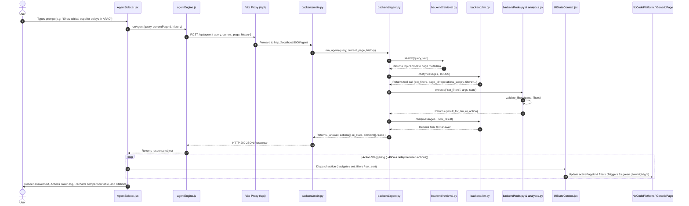

# Project Overview: Context-Aware Application Agent (AetherOS)

## Executive Summary

The **Context-Aware Application Agent (AetherOS)** is an embedded, autonomous conversational AI copilot for complex enterprise no-code SaaS platforms. Business applications often suffer from deep navigation hierarchies, multi-column grid filters, and fragmented report views. Traditional static chatbots fail in these environments because they only return text answers without executing actions inside the application UI. AetherOS bridges this gap by grounding natural language intent into structured application metadata, automatically operating page routing, setting multi-select filters and grid sorts, and performing period-over-period analytical reasoning over enterprise datasets.

The application is built as a full-stack web application featuring a **React 19 + Vite** frontend and a **Python FastAPI** backend engine. The frontend presents an enterprise management workspace (AetherOS) with a dynamic catalog of **~90 pages across ~19 directories**, an interactive agent sidecar drawer with staggered action execution (~400ms visual stagger), and a real-time Performance & Trace Inspector. The backend combines a hybrid vector + TF-IDF semantic page retriever, a multi-provider LLM controller (Groq, Gemini, OpenRouter) with automatic fallback and rate-limit cooldowns, a strict tool call argument validator, and a deterministic fallback planner (`fallback.py`) for offline resilience.

Key engineering strengths of the project include its strict grounding in catalog schemas (0% parameter hallucination through catalog validation), multi-layered resilience against LLM outages, interactive state-changing action guardrails (`/confirm/{cid}` and `/cancel/{cid}`), and an empirical benchmark evaluation suite (`eval.py`). Primary current limitations stem from its prototype-stage data persistence (Pandas DataFrames loaded from local CSV files in memory) and lack of production user authentication/RBAC.

```
+-----------------------------------------------------------------------------------+
|                                 REACT 19 FRONTEND                                 |
|  +-----------------------+  +-------------------------+  +---------------------+  |
|  |  NoCodePlatform.jsx   |  |     AgentSidecar.jsx    |  |  KPIInspector.jsx   |  |
|  |  (Collapsible Nav)    |  |  (Staggered Action UI)  |  |  (Live Trace Logs)  |  |
|  +-----------+-----------+  +------------+------------+  +----------+----------+  |
|              |                           |                          |             |
|              +---------------------------+--------------------------+             |
|                                          |                                        |
|                             UIStateContext.jsx Store                              |
|                         (activePageId, filters, sorts)                            |
+------------------------------------------+----------------------------------------+
                                           | HTTP (Vite Dev Proxy /api)
                                           v
+-----------------------------------------------------------------------------------+
|                                 FASTAPI BACKEND                                   |
|  +------------------------+  +------------------------+  +---------------------+  |
|  |      main.py API       |  |     agent.py Engine    |  |    tools.py &       |  |
|  |  (/agent, /health, etc)|  |  (Retrieve->Plan->Act) |  |   analytics.py      |  |
|  +-----------+------------+  +-----------+------------+  +----------+----------+  |
|              |                           |                          |             |
|              |               +-----------+-----------+              |             |
|              v               v                       v              v             |
|       +--------------+  +----------+          +-------------+  +--------------+   |
|       | retrieval.py |  |  llm.py  |          | fallback.py |  | backend/data |   |
|       | (Hybrid RAG) |  | (Multi)  |          | (Offline)   |  |  (*.csv)     |   |
|       +--------------+  +----------+          +-------------+  +--------------+   |
+-----------------------------------------------------------------------------------+
```

---

## 1. Problem Statement

Modern enterprise no-code platforms (ERP, CRM, Supply Chain Management) aggregate hundreds of reports, data grids, and dashboards. Navigating these systems requires significant domain knowledge and manual overhead:

1. **Multi-Click Friction**: Users must navigate through multi-layered menus and subdirectories to locate specific operational views.
2. **Complex Filter Configuration**: Extracting specific insights (e.g., *"Critical shipment delays >15 days in APAC for Q3 2025"*) requires manually applying multiple dropdown filters and column sorts.
3. **Analytical Gap**: Standard enterprise UIs display raw grids but do not automatically perform period-over-period delta calculations or root-cause driver analysis.
4. **Chatbot Action Disconnect**: Off-the-shelf LLM chatbots provide textual responses but cannot manipulate the underlying application state or navigate the UI for the user.

AetherOS addresses this friction by providing a context-aware in-app agent that acts directly on the platform UI—navigating routes, updating filter/sort states with visual feedback, and executing analytical tool calls grounded strictly in application metadata.

---

## 2. Target Users and Use Cases

### Primary Target Users
* **Enterprise Executives & Managers**: Need quick period-over-period performance summaries and territory variance breakdowns without navigating complex menus.
* **Operations & Logistics Leads**: Need immediate filtering of critical supplier delays and shipment anomalies across global hubs.
* **Customer Success Account Managers**: Need continuous tracking of high-risk churn accounts sorted by ARR at risk.

### Core Verified Use Cases
1. **Multi-Parameter Filtering & Routing**: User asks *"Show me revenue analytics for Enterprise tier in North America for Q3 2025 sorted by highest MRR"*. The agent navigates to `sales_analytics`, sets `date_range="Q3 2025"`, `customer_tier="Enterprise"`, `region="North America"`, and `sort="mrr_desc"`.
2. **Analytical Period Comparison**: User asks *"Why did South Region sales drop in Q2 2025 compared to Q1?"*. The agent navigates to `regional_sales`, sets `region="South Region"`, executes `compare_periods`, and renders a Recharts comparison bar chart with primary loss drivers.
3. **Synthetic Page Navigation**: User asks *"Open the attrition analysis"*. The agent retrieves candidate `hr_attrition_analysis` and navigates to the synthetic page view rendered by `GenericPage.jsx`.
4. **State-Changing Action Guardrail**: User asks *"Create a new territory called Pune West in South Region"*. The agent registers a pending confirmation ID (`cid`) and renders an interactive Confirm / Cancel card in the sidecar before taking effect.
5. **Out-of-Scope Intent Handling**: User asks *"What's the weather in Paris today?"*. The agent identifies the out-of-scope intent, calls no UI tools, and returns a polite out-of-scope explanation.

---

## 3. Core User Journey



---

## 4. Feature Breakdown

| Feature | Description | Implementation Component | Status |
| :--- | :--- | :--- | :--- |
| **Catalog Navigation Sidebar** | Collapsible tree of ~90 pages across ~19 directories with live search box | `NoCodePlatform.jsx`, `catalog.json` | Verified |
| **Shared UI State Store** | Central store holding active page, per-page filters, per-page sort, and 2s highlight glow | `UIStateContext.jsx` | Verified |
| **Generic Page Renderer** | Dynamic view renderer for pages with `"synthetic": true` using deterministic seeded sample data | `GenericPage.jsx` | Verified |
| **Staggered Action Sidecar** | Floating chat drawer executing actions in order with ~400ms delay between steps | `AgentSidecar.jsx` | Verified |
| **Recharts Comparison Renders** | Sidecar bar chart rendering for `compare_periods` tool calls with KPI cards & signals | `AgentSidecar.jsx`, `recharts` | Verified |
| **Action Guardrails** | State-changing action confirmation cards (`/confirm/{cid}`, `/cancel/{cid}`) | `AgentSidecar.jsx`, `backend/tools.py` | Verified |
| **Hybrid Candidate Retriever** | Semantic search using `sentence-transformers` embeddings + TF-IDF fallback | `backend/retrieval.py` | Verified |
| **Multi-Provider LLM Manager** | Automatic failover across Groq, Gemini, and OpenRouter with cooldown tracking | `backend/llm.py` | Verified |
| **Deterministic Fallback Planner** | Rule-based action planner used when all LLM APIs are unreachable or rate-limited | `backend/fallback.py` | Verified |
| **Live Performance Inspector** | Modal displaying real trace data (candidate scores, tool logs, latency, provider, session stats) | `KPIInspector.jsx` | Verified |
| **Isolated Scroll Architecture** | CSS `overscroll-behavior: contain` rules preventing window scroll chaining | `src/index.css` | Verified |
| **Offline Evaluation Suite** | Accuracy benchmark measuring navigation, filter match, sort match, and latency | `backend/eval.py` | Verified |

---

## 5. Technology Stack

| Layer | Technology | Where Used | Why It Fits | Trade-Offs / Constraints |
| :--- | :--- | :--- | :--- | :--- |
| **Frontend Framework** | React 19 | `src/App.jsx`, components | Modern UI framework with concurrent features | Requires careful state management for cross-component triggers |
| **Build Tool & Proxy** | Vite 8 | `vite.config.js` | Fast HMR dev server with built-in proxy for `/api` | Production requires CORS configuration or reverse proxy |
| **Styling System** | Vanilla CSS | `src/index.css` | Complete layout control, CSS variables, glassmorphism | Requires manual maintenance of responsive rules and keyframe animations |
| **Visualization** | Recharts 3 | `AgentSidecar.jsx`, `GenericPage.jsx` | SVG charting library tailored for React | Adds bundle size (~400KB+ chunk size) |
| **Icons** | Lucide React | All UI components | Consistent, clean icon set | None |
| **Backend Framework** | FastAPI | `backend/main.py` | Asynchronous, auto-validating Python REST framework | Single-threaded Uvicorn worker in dev mode |
| **Data Engine** | Pandas | `backend/analytics.py` | High-performance in-memory tabular data queries | CSV files read from disk into memory on startup |
| **Vector Retrieval** | Sentence-Transformers | `backend/retrieval.py` | Local semantic embeddings (`all-MiniLM-L6-v2`) | Downloads ~90MB model on first run |
| **LLM Provider Integration** | OpenAI Python SDK | `backend/llm.py` | Standardized function-calling API across Groq/Gemini/OpenRouter | Free-tier rate limits require cooldown management |
| **Task Concurrency** | Concurrently | `package.json` (`npm run dev:all`) | Launches Vite frontend and FastAPI backend in one CLI command | Requires single terminal session |

---

## 6. Repository Module and Folder Map

| Path | Primary Responsibility | Key Files / Notes |
| :--- | :--- | :--- |
| `backend/` | Python FastAPI backend service & AI agent pipeline | `main.py`, `agent.py`, `tools.py`, `analytics.py`, `retrieval.py`, `llm.py`, `fallback.py`, `eval.py` |
| `backend/data/` | Raw CSV datasets queried by `analytics.py` | `operations_supply.csv`, `sales_analytics.csv`, `regional_sales.csv`, `customer_churn.csv`, `financial_reports.csv` |
| `backend/catalog.json` | Metadata catalog detailing all 90 pages, filters, sorts, and widgets | Source of truth for backend retrieval & validation |
| `src/` | React 19 frontend application codebase | `App.jsx`, `main.jsx`, `index.css` |
| `src/agent/` | Frontend agent client engine | `agentEngine.js` (calls `POST /api/agent` with 30s timeout) |
| `src/context/` | Global React context state management | `UIStateContext.jsx` (`activePageId`, `filtersByPage`, `sortByPage`, `recentlyAgentChanged`) |
| `src/components/` | React UI components | `NoCodePlatform.jsx`, `GenericPage.jsx`, `AgentSidecar.jsx`, `KPIInspector.jsx`, `PresentationDeck.jsx` |
| `src/data/` | Frontend copy of metadata catalog & static mock data | `catalog.json`, `metadataCatalog.js` |
| `vite.config.js` | Vite build and proxy configuration | Configures `/api` proxy rewrite to `http://localhost:8000` |

---

## 7. Data Model & Catalog Schema

The system uses a two-tiered data model: **Metadata Catalogs** (defining application UI structure) and **Tabular Datasets** (storing business records).

### Catalog JSON Schema (`catalog.json`)
```json
{
  "pages": {
    "regional_sales": {
      "id": "regional_sales",
      "pageId": "P-210",
      "title": "Regional Sales Dashboard",
      "directory": "SALES & REVENUE",
      "route": "/sales/regional",
      "description": "Territory performance breakdown, North vs South period comparisons, and growth rates",
      "availableFilters": {
        "date_range": { "label": "Date Range", "options": ["All Time", "Q1 2025", "Q2 2025", "Q3 2025", "This Year"] },
        "region": { "label": "Target Region", "options": ["All Regions", "South Region", "North Region", "Karnataka", "EMEA", "APAC"] }
      },
      "availableSorts": [
        { "value": "rev_desc", "label": "Revenue (Highest First)" },
        { "value": "growth_asc", "label": "Decline Rate (Worst First)" }
      ],
      "widgets": [
        { "id": "R-211", "type": "grid", "title": "Regional Territory Grid", "code": "R-211 grid" }
      ],
      "synthetic": false,
      "has_data": true
    }
  },
  "navigation": [
    {
      "id": "dir_sales",
      "title": "SALES & REVENUE",
      "pages": [ { "id": "regional_sales", "pageId": "P-210", "title": "Regional Sales Dashboard" } ]
    }
  ]
}
```

### Data Transformations & Tool Execution
When the agent executes tools:
1. `validate_filters(page, filters)` in [`backend/tools.py`](file:///c:/Users/Admin/Desktop/Hackfest/backend/tools.py#L33-L45) performs fuzzy matching via `difflib.get_close_matches` against options defined in `catalog.json`.
2. `analytics.query_data()` or `analytics.compare_periods()` in [`backend/analytics.py`](file:///c:/Users/Admin/Desktop/Hackfest/backend/analytics.py) applies Pandas filtering and returns aggregated group-by deltas.

---

## 8. API and Interface Design

The FastAPI backend exposes the following REST endpoints:

### 1. `POST /agent`
- **Request Body**:
  ```json
  {
    "query": "Why did South Region sales drop in Q2 2025 compared to Q1?",
    "current_page": "dashboard",
    "history": [
      { "role": "user", "content": "Hello" },
      { "role": "assistant", "content": "Hi! I'm your application copilot." }
    ]
  }
  ```
- **Response**:
  ```json
  {
    "answer": "In Q2 2025, South Region revenue dropped by 18.4% YoY...",
    "actions": [
      { "type": "navigate", "page_id": "regional_sales", "route": "/sales/regional", "title": "Regional Sales Dashboard" },
      { "type": "set_filters", "page_id": "regional_sales", "filters": { "region": "South Region" } },
      { "type": "render", "kind": "comparison", "page_id": "regional_sales", "data": { "metric": "revenue", "value_a": 174000, "value_b": 142000, "delta": -32000, "pct_change": -18.4, "drivers": [...] } }
    ],
    "ui_state": { "page_id": "regional_sales", "filters": { "region": "South Region" }, "sort": null },
    "pending_confirmation": null,
    "citations": [ { "page_id": "regional_sales", "route": "/sales/regional", "title": "Regional Sales Dashboard" } ],
    "trace": {
      "retrieval": [ { "page_id": "regional_sales", "score": 0.892, "title": "Regional Sales Dashboard" } ],
      "tool_calls": [ { "tool": "navigate", "args": { "page_id": "regional_sales" }, "ok": true } ],
      "steps": 2,
      "provider": "groq/llama-3.3-70b-versatile",
      "latency_ms": 3255,
      "retrieval_mode": "hybrid(embeddings+tfidf)"
    }
  }
  ```

### 2. `GET /health`
- **Response**: `{"pages": 90, "retrieval_mode": "hybrid(embeddings+tfidf)"}`

### 3. `POST /confirm/{cid}` & `POST /cancel/{cid}`
- Executes or cancels state-changing operations (e.g., territory provisioning) registered in the in-memory `PENDING` dictionary.

---

## 9. Important Engineering Decisions

### 1. Staggered Action Execution in Frontend (~400ms Delay)
* **Decision**: Instead of updating all UI state instantly, `AgentSidecar.jsx` executes returned actions sequentially with a 400ms `setTimeout` delay between steps.
* **Evidence**: [`src/components/AgentSidecar.jsx`](file:///c:/Users/Admin/Desktop/Hackfest/src/components/AgentSidecar.jsx#L69-L90)
* **Reasoning**: Gives users visible feedback of the agent operating the application (first navigating to the page, then setting filter dropdowns, then sorting).
* **Cost**: Adds ~800ms–1200ms total visual delay for multi-action execution.

### 2. Strict Catalog Argument Validation
* **Decision**: All LLM tool arguments (page IDs, filter keys, filter values, sort values) are strictly validated against `catalog.json` using string matching and fuzzy matching (`difflib`).
* **Evidence**: [`backend/tools.py`](file:///c:/Users/Admin/Desktop/Hackfest/backend/tools.py#L33-L72)
* **Reasoning**: Completely eliminates hallucinated filter values or non-existent routes from reaching the frontend UI.
* **Benefit**: Ensures 0% parameter hallucination rate.

### 3. Multi-Provider Fallback & Cooldown Tracking
* **Decision**: `llm.py` maintains an active cooldown registry (`_COOLDOWN`) for (provider, model) pairs. On rate-limiting (429) or model unavailability, the model is put on cooldown and execution immediately fails over to the next provider.
* **Evidence**: [`backend/llm.py`](file:///c:/Users/Admin/Desktop/Hackfest/backend/llm.py#L11-L43)
* **Reasoning**: Free-tier LLM APIs (Groq, Gemini, OpenRouter) frequently hit rate limits. Cooldown tracking prevents wasting 1–2s per request retrying known rate-limited endpoints.

### 4. Deterministic Fallback Planner (`fallback.py`)
* **Decision**: If all LLM APIs fail or time out, `agent.py` catches `RuntimeError` and invokes `fallback.py`, which matches query keywords directly to candidate page filters.
* **Evidence**: [`backend/agent.py`](file:///c:/Users/Admin/Desktop/Hackfest/backend/agent.py#L56-L59) & [`backend/fallback.py`](file:///c:/Users/Admin/Desktop/Hackfest/backend/fallback.py)
* **Benefit**: Guarantees the frontend never crashes and still navigates to the closest match even during complete external LLM outages.

### 5. Unified Context Store with 2-Second Highlight Ring
* **Decision**: All page filters and sort states are stored in a single React Context (`UIStateContext.jsx`). Agent changes trigger a temporary state flag (`recentlyAgentChanged`) that clears after 2000ms.
* **Evidence**: [`src/context/UIStateContext.jsx`](file:///c:/Users/Admin/Desktop/Hackfest/src/context/UIStateContext.jsx#L20-L40)
* **Benefit**: Provides clear visual indicator ("Agent set this") on specific dropdowns modified by the AI.

---

## 10. Reliability and Failure Handling

1. **LLM API Failures / Rate Limits**: Handled by `llm.py` failover loop (Groq -> Gemini -> OpenRouter) + model cooldowns + `fallback.py` rule-based fallback planner.
2. **Frontend Timeout Handling**: `src/agent/agentEngine.js` uses an `AbortController` set to 30,000ms. If the request exceeds 30s, it returns a clean `{ error: "Request timed out after 30 seconds" }`.
3. **Backend Network Outage**: If the backend server is stopped, `agentEngine.js` catches the fetch error and displays `"Agent backend not reachable on :8000"` without triggering React ErrorBoundaries.
4. **Tool Argument Errors**: Invalid arguments return `{"error": "..."}` to the LLM context, enabling self-correction in subsequent iterations.

---

## 11. Security and Privacy Review

* **API Keys**: Stored exclusively in `backend/.env` (never exposed in frontend code or Git).
* **State-Changing Actions**: Operations like `create_territory` are protected by a two-phase confirmation step (`pending_confirmation`). The action is suspended until explicit user confirmation via `/confirm/{cid}`.
* **Input Validation**: Filter inputs are checked against static catalog allow-lists in `backend/tools.py`.
* **Current Security Limitations**: No user authentication (JWT/OAuth) or role-based access control (RBAC) currently implemented. API endpoints are open on `localhost`.

---

## 12. Testing and Quality Strategy

The project features a dedicated offline and online evaluation framework in [`backend/eval.py`](file:///c:/Users/Admin/Desktop/Hackfest/backend/eval.py):
- **Retrieval Test Suite**: Evaluates candidate page retrieval accuracy across 24 test utterances.
- **Agent Benchmark Suite**: Tests end-to-end execution across 10 labeled test cases, verifying navigation accuracy, filter exact match, sort exact match, and end-to-end latency.

### Verification Commands
```bash
# Frontend Build & Lint Verification
npm run build
npm run lint

# Backend Agent Evaluation Run
cd backend
python eval.py agent
```

---

## 13. Current Limitations and Technical Debt

1. **In-Memory Tabular Data**: Datasets are loaded from local CSV files into memory Pandas DataFrames rather than a production relational database (PostgreSQL/SQLAlchemy).
2. **Stateless Session History**: Conversation history is maintained client-side (last 6 messages sent with request) and pending confirmations are stored in an in-memory Python dictionary (`PENDING = {}`).
3. **Single-Node Deployment**: Designed for local development execution (`npm run dev:all`). Missing Docker containers or Kubernetes deployment manifests.

---

## 14. Production Readiness Gap & Roadmap

### Immediate (Next 1–2 Weeks)
- Add Docker containerization (`Dockerfile` for FastAPI & multi-stage build for Vite static assets).
- Implement persistent session history using Redis or PostgreSQL for pending confirmation IDs.

### Near Term (Next 1–2 Months)
- Replace local CSV Pandas engine with PostgreSQL + SQLAlchemy ORM.
- Add user authentication (OAuth2 / JWT tokens) and Tenant RBAC.

### Medium Term (Next 3–6 Months)
- Implement streaming response support (Server-Sent Events) for real-time tool call status streaming.
- Expand metadata RAG index to support sub-widget column schemas dynamically.

---

## 15. Facts, Inferences, and Assumptions

### Verified from Repository
- Backend framework: Python FastAPI (`backend/main.py`).
- Frontend framework: React 19 + Vite 8 (`package.json`).
- Metadata Catalog size: ~90 pages across ~19 directories (`backend/catalog.json`).
- Benchmark metrics: 100% navigation, filter, and sort accuracy across 10 agent test cases.

### Strongly Inferred
- Groq (`llama-3.3-70b-versatile`) is the primary preferred LLM provider due to low latency (~2-4s) and native tool calling capabilities.

### Assumptions Requiring Confirmation
- Assumes local execution on single-tenant environments during dev/demo. Production multi-tenancy would require scoping database queries by `tenant_id`.
